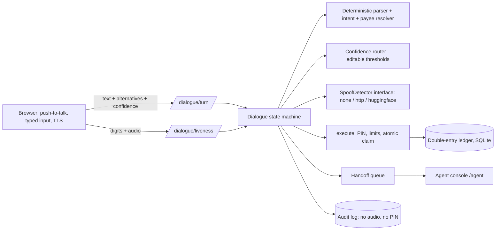

# Design note

**Goal:** let a customer pay by speaking English/Hinglish while never moving money on a misheard amount. Where the system is unsure it asks or hands off.

## Architecture

FastAPI + SQLite (SQLAlchemy). The same service serves the static frontend. State (dialogue sessions, liveness challenges, login sessions) lives in the DB, so restarts and multiple workers are safe.

## Safety decisions
1. Understanding ≠ paying. A turn only fills `{payee, amount}`; money moves only in `handle_execute`.
2. Two methods must agree: deterministic parser vs the speech engine's alternative transcripts. Disagreement → clarify, then handoff.
3. Confirmation is its own step; silence, other speakers and TTS echo are rejected.
4. Liveness = random single-use digits + anti-spoof score. **Policy lives in our code**, not in the detector.
5. Risk rules force the PIN (new payee, ≥ ₹1,000, uncertain/unavailable audio, typed liveness, single-source voice). Voice-only payments therefore stay ≤ ₹999 to saved payees with a passing detector.
6. Hard limits per payment and per rolling 24 h, enforced again inside the ledger transaction.
7. Fuzzy payee matches are only suggestions; ambiguity asks.
8. No LLM: nothing to inject. Instruction-like speech is detected, logged and ignored.

## What was cut (2-day scope)
LLM second opinion (alternative transcripts used instead); a bundled trained detector (interface + providers provided, you must supply/evaluate one); the *confirmation* audio is not scored (only the challenge audio); per-IP rate limiting; separate-origin frontend; Postgres.

## Weakest points
* Chrome frequently returns one transcript only → many voice payments end up "single-source" and need the PIN (safe, but friction).
* Hinglish recognised in Devanagari is handled for numbers/contacts present in the dictionary only.
* Liveness transcript comes from the same browser speech engine; a clone reading the digits passes this layer (by design the PIN / limits / handoff stop it).
* No real detector result exists until you run `scripts/eval_spoof.py`.
